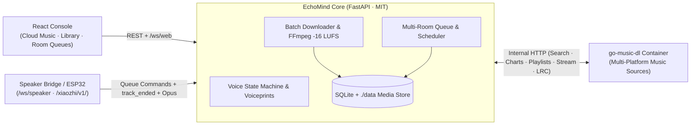

<div align="center">

# EchoMind

**Self-Hosted Family Cloud Music, Podcast & Smart Speaker Hub**

Stream music endlessly, batch-download playlists and charts directly into your server library, follow RSS podcasts, cast across multi-room speakers, and optionally unlock kid-safe picture books, graded English courses, and voiceprint memory isolation.

[简体中文](README.md) · [Key Features](#key-features) · [Quick Start](#quick-start) · [Architecture](#architecture) · [Hardware Integration](#smart-speaker--hardware-integration) · [Contributing](CONTRIBUTING.md)

[](https://github.com/lysforge/echomind/actions/workflows/ci.yml)
[](LICENSE)

</div>

EchoMind is built for whole-household self-hosting on a home NAS or cloud VPS:
- **Core Everyday Experience**: Search across major music platforms, browse live charts, batch-download complete playlists or albums directly onto your server (with LRC lyrics and `-16 LUFS` loudness normalization), subscribe to RSS podcasts, and play via browser or smart speakers across rooms.
- **Thoughtful Family Extensions**: When you add child members with birth year/month, EchoMind dynamically activates age-appropriate storybooks, structured graded English series, per-speaker max-volume protection, and voiceprint-isolated memories.

EchoMind starts with **zero fabricated data** — empty devices, members, and memories by default. The first registered user becomes the admin, and all users can switch seamlessly across four modern UI themes (Warm Radio, Minimal Indigo, Clear Sky, Deep Vinyl).

---

## Key Features

EchoMind features an **ultra-clean, unified 5-tab workspace** — no confusing front/back console switching. Browse, collect/upload directly inside any folder, resume from your exact second, and cast to any room speaker in seconds.

| Workspace | Capabilities |
| --- | --- |
| **📖 Story Library** | **3-level tree (`Series → Season → Episode`)** with exact playback position memory (`Season · Episode · mm:ss`), one-click resume, **automatic cross-season playback** when a season ends, plus in-place online search/fetch, URL import, batch audio upload, and text-to-speech synthesis. |
| **🎵 Music Library** | Clean `Artist / Playlist → Album → Track` catalog combined directly with multi-source search, live charts, playlist resolution, automatic fallback source switching, and batch server downloads (with LRC lyrics and `-16 LUFS` normalization via companion `go-music-dl`). |
| **🔤 English Enlightenment** | Graded **L1–L5 learning ladder** (`L1 Nursery Songs` → `L2 Phonics & Daily` → `L3 Graded Readers` → `L4 Chapter Stories` → `L5 Native Fluency`), persistent resume banner, tap-to-pronounce vocabulary cards, completion tracking, AI unit generator, custom audio import, and speaker casting. |
| **🎙️ Podcasts** | Channel → Season → Episode podcast library with built-in RSS subscriptions, preset directories, auto-sync, and exact progress resume. |
| **🔊 Speakers & Settings** | Multi-room Sonos/Connect-style playback queues, hearing-protection max volume, minute/episode sleep timers, daily cron schedules, family voiceprint memory isolation, background collection task monitor, local folder scanner, and LLM/account settings. |

### Voice-Driven Collection, AI Auto-Classification & Speaker Announcements

- **Voice Collect & Auto-Classify**: Ask your speaker to collect stories, songs, or English lessons → EchoMind fetches audio in the background, uses LLM/rules to classify it automatically into the right **Channel → Series → Season → Episode**, and **announces completion directly on the speaker** (with real-time web notifications).
- **Precision Voice Navigation**: Resume any series from its remembered season/episode/second, jump directly to a specific season and episode (supporting both Arabic and Chinese numerals), jump within the active speaker queue, adjust volume safely, or set sleep timers.

---

## Architecture

EchoMind stays cleanly licensed under **MIT** and runs as a single self-contained stack (FastAPI + SQLite + React), communicating over internal HTTP with an optional `go-music-dl` container orchestrated via `docker-compose.yml`. When the companion music engine is not running, all core library, podcast, speaker queue, and built-in fallback search features continue operating independently.



---

## Quick Start

### Option 1: Docker Compose (Recommended for Cloud VPS / NAS)

Starts both **EchoMind (`:8090`)** and the **companion multi-source music engine**:

```bash
git clone https://github.com/lysforge/echomind.git
cd echomind
docker compose up -d --build
```

1. Open **`http://<your-server-ip>:8090`** in your browser and register the first user (automatically granted admin privileges).
2. All SQLite state, downloaded audio, and lyrics persist in `./data`.
3. The companion engine binds strictly to `127.0.0.1:18080` on the host; use SSH port forwarding if you wish to configure optional platform cookies locally without exposing the downloader port publicly.

### Option 2: Run Natively (macOS / Linux)

Requires `Node.js 20+`, `Python 3.11–3.13`, and `ffmpeg`:

```bash
git clone https://github.com/lysforge/echomind.git
cd echomind
chmod +x start.sh
./start.sh
```

Optionally launch the companion container locally alongside `./start.sh`:

```bash
docker run -d --name echomind-music-dl -p 127.0.0.1:18080:8080 guohuiyuan/go-music-dl:latest ./music-dl web --port 8080 --no-browser
```

---

## Smart Speaker & Hardware Integration

- **Bridge Script (`clients/echomind_xiaoai_agent.py`)**: Download pre-filled bridge scripts after creating a speaker in **Hardware, Users & System** to receive full album queues and auto-advance via `track_ended`.
- **6-Digit Pairing Discovery**: Unregistered speakers connecting to `/ws/speaker` enter a pending claim pool with a 6-digit pairing code.
- **ESP32 Voice Hardware**: Full `/xiaozhi/ota/` and `/xiaozhi/v1/` Opus frame WebSocket support.

---

## Privacy & Responsible Use

- EchoMind does not bundle copyrighted media. The optional companion music container runs in a separate process under its own license; users are responsible for complying with local copyright laws and source terms of service.
- All credentials, libraries, voiceprint vectors, and lyrics remain stored locally in `./data`.
- Licensed under the [MIT License](LICENSE).
