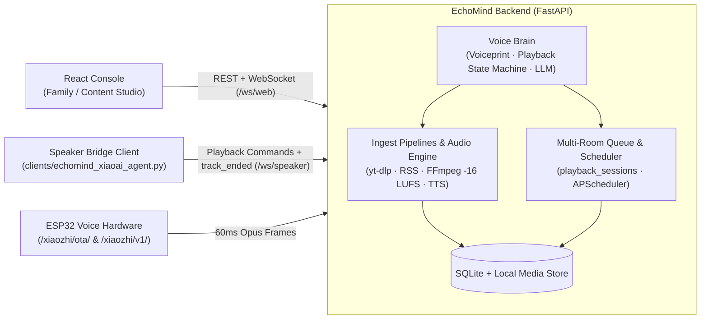

<div align="center">

# EchoMind

**Self-Hosted Family Smart Speaker, Multi-Stage Audio Library & Voiceprint Memory Hub**

Bring music, picture books, graded English courses, RSS podcasts, multi-room speaker queues, and voiceprint-isolated family memories into one clean, private self-hosted space.

[简体中文](README.md) · [Key Features](#key-features) · [Quick Start](#quick-start) · [Architecture](#architecture) · [Hardware Integration](#smart-speaker--hardware-integration) · [Contributing](CONTRIBUTING.md)

[](https://github.com/lysforge/echomind/actions/workflows/ci.yml)
[](LICENSE)

</div>

EchoMind is a lightweight, self-hosted audio and smart speaker control hub designed for households with members of all ages. Built on a single cohesive stack (FastAPI + SQLite + React), it runs directly on a home NAS, Mac mini, or Linux server without requiring external smart-home platforms.

EchoMind follows a **zero fake-data policy**: fresh installations start cleanly with zero pre-fabricated devices, members, or mock logs. The first registered account automatically becomes the platform administrator, with role-based access control (RBAC) for additional family accounts and four switchable UI themes (Warm Radio, Minimal Indigo, Clear Sky, and Deep Vinyl).

---

## Key Features

EchoMind separates daily listening from backend administration with two distinct workspaces: a distraction-free **Family Listening Console** and an admin-only **Content Studio & System Console**.

### 1. Family Listening Console

| Space | Capabilities |
| --- | --- |
| **Discover & Albums** | Unifies music, picture books, graded English series, and podcasts into a consistent **Album → Track** model with 4 channels and customizable sub-tags, age-aware ranking per family member, resume-from-last-track, browser playback, and instant online audio search & play. |
| **Rooms & Sleep Timers** | Sonos/Connect-style multi-room playback: push full album queues to multiple connected speakers at once, control sequential / repeat-one / shuffle playback, set sleep timers by duration or remaining episodes, and schedule daily automated playback routines. |
| **Family & Voiceprints** | Tracks growth dynamically via birth month/year (`0-3`, `3-6`, `6-9`, `9-12`, `12-18`, and `All-Age`) alongside English proficiency stages (`Pre-A1` through `B2+`); supports in-browser voiceprint enrollment and three-tier memory isolation (`family`, `personal`, `growth`). |
| **Voice Control Drawer** | Send natural-language voice or text commands (play specific episodes, next/previous track, adjust volume, pause/resume, or stop after N minutes/episodes) via microphone recording or text input. |

### 2. Admin Content Studio & System Settings

| Space | Capabilities |
| --- | --- |
| **Catalog & Taxonomy** | Manage channel sub-tags, edit album metadata (age stage, English stage, language, playback mode), reorder tracks, and inspect accompanying story scripts or vocabulary cards. |
| **Five Content Pipelines** | 1. **Voice Cache Inbox** (review auto-cached online tracks and promote them into curated albums); 2. **Local Folder Scanner** (index `.mp3/.m4a/.wav/.flac/.ogg/.opus/.aac` and paired `.txt` scripts); 3. **Upload & URL Fetch** (upload files or collect media via `yt-dlp`); 4. **Podcast RSS Subscriptions** (preview feeds and run incremental deduplicated syncs); 5. **Text-to-Audio & AI Course Builder** (synthesize read-aloud tracks or generate 4-lesson themed English series). |
| **Hardware, Users & System** | Pre-provision speakers or claim newly discovered hardware via 6-digit pairing codes, export pre-filled bridge scripts, enforce per-speaker hearing-protection max volume (`max_volume`) and quiet hours, configure LLM/ASR/voiceprint endpoints, and manage family user accounts. |

---

## Core Engineering Highlights

- **Local-First → Instant Live Stream + Background Auto-Cache**: Voice playback checks the local library first; on cache miss, EchoMind streams audio immediately via FFmpeg transcoding while saving and normalizing a local copy into the Voice Cache Inbox in the background (with age-appropriate local story fallback when offline).
- **On-Demand Synthesis & `-16 LUFS` Loudness Normalization**: Text-backed stories and English lesson scripts synthesize audio cleanly on first playback and pass through FFmpeg `loudnorm` targeting `-16 LUFS` so playback volume stays consistent and ear-safe across sources.
- **Server-Side Room Queues & Voice State Machine**: Connected hardware reports natural completion (`track_ended`) over WebSocket to advance queues automatically and honor episode-based or timed sleep stops. Voice volume commands are strictly clamped by each device's `max_volume`.
- **Fail-Safe Voiceprint Privacy**: Built-in 64-bin mel envelope + pitch F0 speaker matching (or optional external `3D-Speaker` service). Unrecognized voices or low-confidence matches automatically fall back to `child_safe` mode and never expose private adult memories.

---

## Architecture



---

## Quick Start

### Option 1: Docker Compose (Recommended for NAS / Linux)

Requires Docker Engine / Docker Compose:

```bash
git clone https://github.com/lysforge/echomind.git
cd echomind
docker compose up -d --build
```

The service listens on `http://localhost:8090`, storing SQLite state and media files in `./data`. Uncomment the extra volume mount in `docker-compose.yml` to scan an existing host audio directory.

### Option 2: Run Natively (macOS / Linux)

Prerequisites: `Node.js 20+`, `Python 3.11–3.13`, and `ffmpeg` (`brew install ffmpeg` on macOS or `sudo apt install ffmpeg` on Ubuntu/Debian).

```bash
git clone https://github.com/lysforge/echomind.git
cd echomind
chmod +x start.sh
./start.sh
```

`start.sh` builds the frontend bundle, initializes the Python virtual environment, and launches Uvicorn on `0.0.0.0:8090` (override with `PORT=9000 ./start.sh`).

### Initial Setup

1. Open **`http://localhost:8090`** in your browser.
2. Register the first user — **this account automatically receives administrator privileges**.
3. Complete the onboarding wizard to configure home/assistant names, optional LLM credentials (DeepSeek, OpenAI-compatible APIs, or Ollama — works offline without a key via local intent routing), your first family member, and your first speaker.

---

## Smart Speaker & Hardware Integration

- **Speaker Bridge Client**: Creating a speaker in **Hardware, Users & System** provides an `auth_token` and a downloadable pre-configured script based on `clients/echomind_xiaoai_agent.py` to connect speakers or Raspberry Pi / PC audio endpoints over `/ws/speaker`.
- **Zero-Config Discovery**: Unregistered devices connecting to `/ws/speaker` receive a 6-digit `pair_code` and appear in the pending claim pool for instant one-click approval.
- **ESP32 Voice Hardware Compatibility**: Exposes `/xiaozhi/ota/` and `/xiaozhi/v1/` WebSocket endpoints with 60ms Opus frame streaming and motion safety bounds.

---

## Privacy & Responsible Use

- Credentials, family memories, voiceprint embeddings, playback progress, and cached media stay stored locally inside `./data`. Prompts or audio snippets are sent externally only when you explicitly configure cloud LLM or ASR API providers.
- Keep EchoMind on your trusted LAN or behind an authenticated reverse proxy; avoid exposing unauthenticated setup or admin ports directly to the public internet.
- Ensure podcast feeds and downloaded URLs comply with your local copyright laws and source terms of service.

---

## License

Released under the [MIT License](LICENSE).
