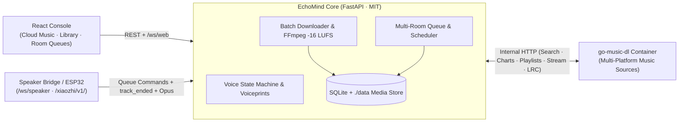

<div align="center">

# EchoMind

**Self-Hosted Family Cloud Music, Podcast & Smart Speaker Hub**

Stream music endlessly, batch-download playlists and charts directly into your server library, follow RSS podcasts, cast across multi-room speakers, and optionally unlock kid-safe picture books, graded English courses, and voiceprint memory isolation.

[简体中文](README.md) · [Key Features](#key-features) · [Quick Start](#quick-start) · [Architecture](#architecture) · [Hardware Integration](#smart-speaker--hardware-integration) · [Contributing](CONTRIBUTING.md)

[](https://github.com/lysforge/echomind/actions/workflows/ci.yml)
[](LICENSE)

</div>

EchoMind is built for whole-household self-hosting on a home NAS or cloud VPS:
- **Core Everyday Experience**: Search across major music platforms, browse live charts, batch-download complete playlists or albums directly onto your server (with LRC lyrics and `-16 LUFS` loudness normalization), subscribe to RSS podcasts, and play via browser or smart speakers across rooms.
- **Thoughtful Family Extensions**: When you add child members with birth year/month, EchoMind dynamically activates age-appropriate storybooks, structured graded English series, per-speaker max-volume protection, and voiceprint-isolated memories.

EchoMind starts with **zero fabricated data** — empty devices, members, and memories by default. The first registered user becomes the admin, and all users can switch seamlessly across four modern UI themes (Warm Radio, Minimal Indigo, Clear Sky, Deep Vinyl).

---

## Key Features

EchoMind keeps daily listening distraction-free by separating the **Family Listening Console** from the admin-only **Content Studio**.

### 1. Family Listening Console

| Space | Capabilities |
| --- | --- |
| **Cloud Music & Batch Download** | Powered by a companion `go-music-dl` engine via Docker Compose: aggregate search across NetEase, QQ Music, Kugou, Kuwo, Migu, Bilibili, and more; browse live toplists; resolve full playlists/albums; stream with automatic fallback source switching; and batch-download tracks directly into persistent server albums with LRC lyrics. |
| **Private Library & Podcasts** | Unified **Album → Track** organization across music playlists, RSS podcasts, picture books, and graded English courses, featuring custom sub-tags, age-aware member sorting, progress resume, and one-click speaker casting. |
| **Multi-Room Speakers & Timers** | Sonos/Connect-style server-managed queues pushing entire albums to multiple rooms simultaneously, loop modes, sleep timers (by minutes or episode count), and daily cron schedules. |
| **Family & Voiceprints** | Dynamic age-stage & English-stage tracking, in-browser voiceprint enrollment, and three-tier memory isolation (`family`, `personal`, `growth`) with fail-safe fallback to `child_safe` mode. |
| **Voice Control Drawer** | Natural-language playback commands (play tracks/episodes, next/previous, adjust volume clamped to `max_volume`, pause/resume, sleep timers) via voice or text. |

### 2. Admin Content Studio & System Settings

- **Catalog & Sub-Tag Management**: Customize channel sub-tags and track/lyric metadata.
- **Five Content Ingest Pipelines**: Voice Cache Inbox (promote auto-cached online plays into curated albums), Local Folder Scanner, Upload & URL Fetch (`yt-dlp`), Podcast RSS Subscriptions, and Text-to-Audio / AI English Course Builder.
- **Hardware, Users & Settings**: Configure companion `go-music-dl` URL & sources, LLM providers (DeepSeek / OpenAI-compatible / Ollama), TTS voices, hearing-protection max volume, quiet hours, 6-digit speaker pairing codes, and multi-user RBAC.

---

## Architecture

EchoMind stays cleanly licensed under **MIT** and runs as a single self-contained stack (FastAPI + SQLite + React), communicating over internal HTTP with an optional `go-music-dl` container orchestrated via `docker-compose.yml`. When the companion music engine is not running, all core library, podcast, speaker queue, and built-in fallback search features continue operating independently.



---

## Quick Start

### Option 1: Docker Compose (Recommended for Cloud VPS / NAS)

Starts both **EchoMind (`:8090`)** and the **companion multi-source music engine**:

```bash
git clone https://github.com/lysforge/echomind.git
cd echomind
docker compose up -d --build
```

1. Open **`http://<your-server-ip>:8090`** in your browser and register the first user (automatically granted admin privileges).
2. All SQLite state, downloaded audio, and lyrics persist in `./data`.
3. The companion engine binds strictly to `127.0.0.1:18080` on the host; use SSH port forwarding if you wish to configure optional platform cookies locally without exposing the downloader port publicly.

### Option 2: Run Natively (macOS / Linux)

Requires `Node.js 20+`, `Python 3.11–3.13`, and `ffmpeg`:

```bash
git clone https://github.com/lysforge/echomind.git
cd echomind
chmod +x start.sh
./start.sh
```

Optionally launch the companion container locally alongside `./start.sh`:

```bash
docker run -d --name echomind-music-dl -p 127.0.0.1:18080:8080 guohuiyuan/go-music-dl:latest ./music-dl web --port 8080 --no-browser
```

---

## Smart Speaker & Hardware Integration

- **Bridge Script (`clients/echomind_xiaoai_agent.py`)**: Download pre-filled bridge scripts after creating a speaker in **Hardware, Users & System** to receive full album queues and auto-advance via `track_ended`.
- **6-Digit Pairing Discovery**: Unregistered speakers connecting to `/ws/speaker` enter a pending claim pool with a 6-digit pairing code.
- **ESP32 Voice Hardware**: Full `/xiaozhi/ota/` and `/xiaozhi/v1/` Opus frame WebSocket support.

---

## Privacy & Responsible Use

- EchoMind does not bundle copyrighted media. The optional companion music container runs in a separate process under its own license; users are responsible for complying with local copyright laws and source terms of service.
- All credentials, libraries, voiceprint vectors, and lyrics remain stored locally in `./data`.
- Licensed under the [MIT License](LICENSE).
