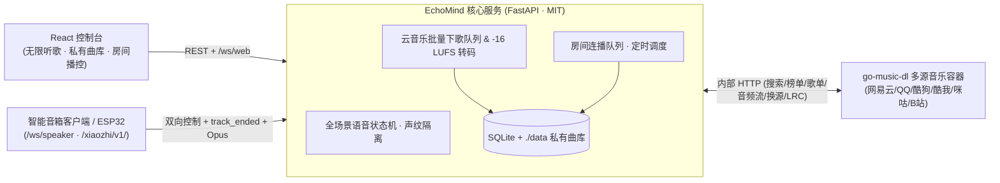

<div align="center">

# EchoMind

**声忆 — 面向全家人的私有云音乐、播客电台与智能音箱中枢**

把无限听歌、云端歌单批量下载攒曲库、RSS 播客追更、全屋多音箱连播，以及给孩子准备的绘本与分级英语伴学，放进一个干净自托管的家庭私有服务。

[English](README.en.md) · [核心能力](#核心能力) · [快速开始](#快速开始) · [架构与伴生引擎](#架构与伴生引擎) · [硬件接入](#智能音箱与硬件接入) · [参与贡献](CONTRIBUTING.md)

[](https://github.com/lysforge/echomind/actions/workflows/ci.yml)
[](LICENSE)

</div>

EchoMind 是一套专为家庭和个人云部署设计的声音中枢平台：
- **大人随时随地用**：部署在家庭 NAS 或云服务器上，多源聚合搜歌、刷各平台热歌榜、把喜欢的歌单和歌手专辑整批下载到服务器持久化存曲库（自动附带 LRC 歌词与响度均衡）、追更播客节目，并通过浏览器或全屋智能音箱无缝畅听。
- **有孩子家庭的延伸能力**：当你为家人建档并填写出生年月后，系统自动激活适龄成长频道，提供睡前绘本一键合音、分级英语伴学系列课、护耳音量上限与基于声纹的儿童安全记忆隔离。

系统坚持**零假数据初始态**：首次启动不预设任何假音箱、假成员或假记录；首个注册用户自动成为管理员，并内置四套现代界面主题一键换肤（暖阳电台、极简科技、晴空伴学、深邃黑胶）。

---

## 核心能力

界面采用**极简所见即所得**的一体化设计——彻底取消繁琐的前后台反复切换，左侧仅保留 **5 个直白入口**，登录 3 秒即可上手，每个分类内直接浏览、就地采集/上传、续播并一键推送房间音箱。

| 频道 / 模块 | 核心体验与工程能力 |
| --- | --- |
| **📖 故事书架** | **三级树形分类（合集系列 → 第几季 → 第几集）**，例如「汪汪队 → 第2季 → 第5集」；精准记录上次播放到第几季、第几集、第几秒，支持一键续播、播完本季**自动跨季连播下一季**，以及在任意季内就地全网搜集下载、粘贴链接抓取、批量上传与文本合成朗读。 |
| **🎵 音乐曲库** | 同样的三级分类管理（歌手/歌单 → 专辑 → 单曲），并直接内置**全网无限搜歌、热歌榜单、歌单解析与整批下载**（通过伴生 `go-music-dl` 引擎打通多源平台、自动换源试听并附带 LRC 歌词与 `-16 LUFS` 护耳校准）。 |
| **🔤 英语启蒙** | 参考成熟启蒙体系打造的 **L1 ~ L5 五阶分级学习台**（L1 磨耳朵儿歌 → L2 拼读与日常 → L3 分级绘本 → L4 故事听说 → L5 原版进阶），自动记忆上次学到哪一级哪一课第几秒，支持核心词汇卡美音点读、学习打卡进度条、AI 生成主题单元、导入自有牛津树/RAZ 音频与一键推音箱熏听。 |
| **🎙️ 播客电台** | 按频道与节目季整理播客，就地支持 RSS 订阅、精选源一键导入、定时拉取最新期与断点续听。 |
| **🔊 音箱与设置** | 整合全屋各房间音箱的实时连播队列、护耳音量上限、按分钟/按集数睡眠定时、每日定时日程、家人声纹与三层记忆隔离、后台采集任务与本地磁盘目录扫描，以及大模型/账号配置。 |

### 语音操控与 AI 自动采集闭环

对着音箱或网页语音抽屉自然说话即可全链路闭环操控：
- **语音触发采集 + AI 自动分类 + 音箱播报通知**：说出 *「帮我采集汪汪队第二季的故事」* 或 *「帮我下载周杰伦的歌」* → 后台自动全网搜索下载 → AI 自动识别频道、一级合集、第几季与集号完成分类入库 → **采集完成后由音箱主动语音播报结果并实时弹窗通知网页端**。
- **精准跳季跳集与断点续播**：支持 *「播放汪汪队」*（自动从上次听到的第几季第几集第几秒续播）、*「播放汪汪队第二季第五集」*（中文/阿拉伯数字跳季跳集）、*「跳到第3集」*（当前队列实时跳集）、*「继续学L1英语」*、*「音量调到45」*、*「20分钟后停止」*。

---

## 架构与伴生引擎

EchoMind 自身主仓库保持纯 **MIT License** 轻量单栈（FastAPI + SQLite + React），通过 **Docker Compose 松耦合编排** 可选连接多源音乐容器 `guohuiyuan/go-music-dl`，通过内部 HTTP 通信取流与拉取歌词；即使独立启动不开启音乐伴生容器，核心私有曲库、播客、音箱播控与内置双源点播依然 100% 独立可用。



### 核心工程保证
- **云服务器永久沉淀私有曲库**：后台异步任务并发下载选定歌曲或整张歌单，经 `FFmpeg loudnorm` 统一校准至 `-16 LUFS` 护耳标准、同步写入 LRC 歌词并按 `source:id` 自动去重，即使外部网页链接失效或服务器断外网也能永久在本地私有库畅听。
- **实时听歌智能换源**：网页端直播某首歌曲时若遇 VIP 受限或上游失效，自动调用换源接口匹配同名原唱替代音源。
- **听音护耳与安全边界**：音箱可配置硬件 `max_volume` 硬限幅，无论网页拖动或语音指令调节音量均不可越界。

---

## 快速开始

### 方式一：Docker Compose 一键云端/NAS 部署（推荐）

同时拉起 **EchoMind 主服务（8090 端口）** 与 **多源音乐伴生引擎**：

```bash
git clone https://github.com/lysforge/echomind.git
cd echomind
docker compose up -d --build
```

- 打开浏览器访问 **`http://<你的服务器IP>:8090`** 即可开始使用（注册的第一个账号自动成为超级管理员）。
- 所有数据库、私有音乐曲库与歌词均持久化在当前目录 `./data`。
- 伴生音乐容器默认仅绑定宿主机回环 `127.0.0.1:18080`；如需为网易云/QQ音乐配置会员 Cookie 以解锁高音质或读取个人歌单，可通过 SSH 端口转发在本机安全访问 `http://127.0.0.1:18080/music` 扫码登录，不对外暴露管理风险。

### 方式二：本机直接运行（macOS / Linux）

前置依赖：`Node.js 20+`、`Python 3.11 ~ 3.13` 以及系统安装 `ffmpeg`。

```bash
git clone https://github.com/lysforge/echomind.git
cd echomind
chmod +x start.sh
./start.sh
```

本地启动默认监听 `http://127.0.0.1:8090`。如想在本地开发模式下一并体验全网榜单与多源搜歌，可额外起一行伴生音乐容器并在后台「系统设置」保持地址为 `http://127.0.0.1:18080`：

```bash
docker run -d --name echomind-music-dl -p 127.0.0.1:18080:8080 guohuiyuan/go-music-dl:latest ./music-dl web --port 8080 --no-browser
```

---

## 智能音箱与硬件接入

- **小米小爱音箱真机直连（免刷机）**：内置基于 `miservice-fork` 的小爱云端直连引擎，在「音箱与设置 → 小爱真机与小智MCP」登录小米账号即可自动发现家里所有小爱音箱一键绑定，支持直接推送音频流、播完自动跨季连播、采集完成主动开口播报（播报完自动恢复原故事）、护耳音量硬限幅，以及开启语音指令自动接管。
- **ESP32 小智开源语音硬件 & 标准 MCP Server**：
  - 支持直接把小智 OTA 指向 `/xiaozhi/ota/` 享受原生 `/xiaozhi/v1/` Opus 断点续播与跨季自动连播；
  - 同时内置标准 JSON-RPC 2.0 **MCP Server（`POST /api/mcp`）**，可直接挂载到已有的 `xiaozhi-esp32-server` 或任意 MCP Agent 中调用点播、跳季跳集、语音采集分类与房间推送工具。
- **通用音箱 / 树莓派 / Mac 桥接**：下载专属 `clients/echomind_xiaoai_agent.py` 脚本连入 `/ws/speaker`，原生支持 `start_position_sec` 断点跳转、每 5 秒 `progress_report` 精确秒数上报与通知播报后自动恢复原音频。
- **网盘 WebDAV / 本地三级目录与存储运维**：支持 OpenList / AList / NAS WebDAV 一键按 `系列/第X季/单集.mp3` 同步建树、本地目录扫描与 `mutagen` ID3 自动按「歌手 → 专辑」归档、云服务器磁盘空间监控与缓存清理，以及手机 PWA 锁屏控制（MediaSession）。

---

## 隐私、合规与开源协议

- **仅作个人合法音频管理与学习交流**：EchoMind 本体不预置、不分发任何受版权保护的音视频内容；伴生多源搜索引擎作为独立第三方开源项目按其各自协议在用户自己的容器中运行，请在使用过程中自觉遵守相关平台的版权与服务条款。
- **数据私有留存**：账号信息、家庭记忆、声纹与曲库均留存本地 `./data`；仅在显式填写外部大模型/语音识别 Key 时对话才发往对应推理接口。
- 本项目主代码基于 [MIT License](LICENSE) 开源。
