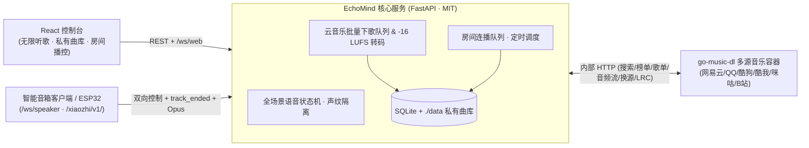

<div align="center">

# EchoMind

**声忆 — 面向全家人的私有云音乐、播客电台与智能音箱中枢**

把无限听歌、云端歌单批量下载攒曲库、RSS 播客追更、全屋多音箱连播，以及给孩子准备的绘本与分级英语伴学，放进一个干净自托管的家庭私有服务。

[English](README.en.md) · [核心能力](#核心能力) · [快速开始](#快速开始) · [架构与伴生引擎](#架构与伴生引擎) · [硬件接入](#智能音箱与硬件接入) · [参与贡献](CONTRIBUTING.md)

[](https://github.com/lysforge/echomind/actions/workflows/ci.yml)
[](LICENSE)

</div>

EchoMind 是一套专为家庭和个人云部署设计的声音中枢平台：
- **大人随时随地用**：部署在家庭 NAS 或云服务器上，多源聚合搜歌、刷各平台热歌榜、把喜欢的歌单和歌手专辑整批下载到服务器持久化存曲库（自动附带 LRC 歌词与响度均衡）、追更播客节目，并通过浏览器或全屋智能音箱无缝畅听。
- **有孩子家庭的延伸能力**：当你为家人建档并填写出生年月后，系统自动激活适龄成长频道，提供睡前绘本一键合音、分级英语伴学系列课、护耳音量上限与基于声纹的儿童安全记忆隔离。

系统坚持**零假数据初始态**：首次启动不预设任何假音箱、假成员或假记录；首个注册用户自动成为管理员，并内置四套现代界面主题一键换肤（暖阳电台、极简科技、晴空伴学、深邃黑胶）。

---

## 核心能力

界面采用前后台彻底解耦设计——日常打开是纯粹好用的**家庭听音台**，管理员可一键切换至**内容工坊与管理后台**。

### 1. 前台 · 家庭听音台

| 模块 | 核心体验与工程能力 |
| --- | --- |
| **无限听歌与下歌** | 伴生接入 `go-music-dl` 多源聚合引擎，打通网易云、QQ音乐、酷狗、酷我、咪咕、Bilibili 等平台并发搜歌、热门排行榜与歌单/专辑链接解析；支持浏览器实时试听（失效自动换源）与**一键整批/全榜下载到云服务器私有曲库**，同步抓取 LRC 歌词。 |
| **私有曲库与播客** | 统一「专辑 → 单集」结构管理私有歌曲、RSS 播客以及伴学内容，支持四频道 + 二级分类标签筛选、点击成员卡片智能置顶适配内容、断点续播与一键推给任意音箱。 |
| **房间音箱与定时** | Sonos / Connect 级跨房间音频推送，支持多音箱同时推入整张专辑队列连播、循环模式切换、**按分钟或按剩余集数轻柔睡眠定时**，以及每天定时播控日程。 |
| **家人声纹与记忆** | 支持为每位家人录入声纹特征并建档（支持儿童成长阶段与英语等级动态推算），严格划分「家庭共享 / 个人私密 / 成长动态」三层记忆，未达置信度默认回退儿童安全模式。 |
| **全局语音控制抽屉** | 随时通过语音或文本点播歌曲/故事、换集（上一首/下一首）、调音量、暂停/续播及语音设睡眠定时（支持本地曲库命中优先，未命中自动在线转码秒播并后台静默存库）。 |

### 2. 后台 · 内容工坊与管理中心（仅管理员）

| 模块 | 运营与系统配置能力 |
| --- | --- |
| **专辑编目与分类** | 四频道二级分类标签（如经典歌单、哄睡轻音乐、科学百科、睡前绘本等）自由维护，专辑与单集歌词/文稿、词汇卡及播放顺序管理。 |
| **五大内容填充管道** | ① **语音缓存收件箱**（全网实时边播边存下来的音频试听后一键转正移入正式专辑）；② **本地目录挂载扫描**（支持 `.mp3/.m4a/.wav/.flac/.ogg/.opus/.aac` 及同名 `.txt` 文稿）；③ **上传与 URL 抓取**；④ **播客 RSS 订阅追更**；⑤ **文本合音与 AI 英语制课**（可选特色功能）。 |
| **硬件·账号·系统设置** | 配置伴生音乐引擎地址与音源、大模型（DeepSeek / OpenAI 兼容 / Ollama）、TTS 音色、护耳最大音量上限、夜间免打扰时段、6 位配对码音箱认领以及多账号 RBAC 权限管理。 |

---

## 架构与伴生引擎

EchoMind 自身主仓库保持纯 **MIT License** 轻量单栈（FastAPI + SQLite + React），通过 **Docker Compose 松耦合编排** 可选连接多源音乐容器 `guohuiyuan/go-music-dl`，通过内部 HTTP 通信取流与拉取歌词；即使独立启动不开启音乐伴生容器，核心私有曲库、播客、音箱播控与内置双源点播依然 100% 独立可用。



### 核心工程保证
- **云服务器永久沉淀私有曲库**：后台异步任务并发下载选定歌曲或整张歌单，经 `FFmpeg loudnorm` 统一校准至 `-16 LUFS` 护耳标准、同步写入 LRC 歌词并按 `source:id` 自动去重，即使外部网页链接失效或服务器断外网也能永久在本地私有库畅听。
- **实时听歌智能换源**：网页端直播某首歌曲时若遇 VIP 受限或上游失效，自动调用换源接口匹配同名原唱替代音源。
- **听音护耳与安全边界**：音箱可配置硬件 `max_volume` 硬限幅，无论网页拖动或语音指令调节音量均不可越界。

---

## 快速开始

### 方式一：Docker Compose 一键云端/NAS 部署（推荐）

同时拉起 **EchoMind 主服务（8090 端口）** 与 **多源音乐伴生引擎**：

```bash
git clone https://github.com/lysforge/echomind.git
cd echomind
docker compose up -d --build
```

- 打开浏览器访问 **`http://<你的服务器IP>:8090`** 即可开始使用（注册的第一个账号自动成为超级管理员）。
- 所有数据库、私有音乐曲库与歌词均持久化在当前目录 `./data`。
- 伴生音乐容器默认仅绑定宿主机回环 `127.0.0.1:18080`；如需为网易云/QQ音乐配置会员 Cookie 以解锁高音质或读取个人歌单，可通过 SSH 端口转发在本机安全访问 `http://127.0.0.1:18080/music` 扫码登录，不对外暴露管理风险。

### 方式二：本机直接运行（macOS / Linux）

前置依赖：`Node.js 20+`、`Python 3.11 ~ 3.13` 以及系统安装 `ffmpeg`。

```bash
git clone https://github.com/lysforge/echomind.git
cd echomind
chmod +x start.sh
./start.sh
```

本地启动默认监听 `http://127.0.0.1:8090`。如想在本地开发模式下一并体验全网榜单与多源搜歌，可额外起一行伴生音乐容器并在后台「系统设置」保持地址为 `http://127.0.0.1:18080`：

```bash
docker run -d --name echomind-music-dl -p 127.0.0.1:18080:8080 guohuiyuan/go-music-dl:latest ./music-dl web --port 8080 --no-browser
```

---

## 智能音箱与硬件接入

- **普通音箱 / 树莓派 / Mac 桥接**：在后台添加音箱后可下载专属 `clients/echomind_xiaoai_agent.py` 脚本，连入 `/ws/speaker` 接收整张专辑连播队列，并在每首歌播放结束自动触发下一首。
- **6 位配对码零配置认领**：陌生设备直连 `/ws/speaker` 会自动进入待认领池并生成 6 位配对码。
- **ESP32 小智开源语音硬件**：内置 `/xiaozhi/ota/` 与 `/xiaozhi/v1/` WebSocket 协议支持。

---

## 隐私、合规与开源协议

- **仅作个人合法音频管理与学习交流**：EchoMind 本体不预置、不分发任何受版权保护的音视频内容；伴生多源搜索引擎作为独立第三方开源项目按其各自协议在用户自己的容器中运行，请在使用过程中自觉遵守相关平台的版权与服务条款。
- **数据私有留存**：账号信息、家庭记忆、声纹与曲库均留存本地 `./data`；仅在显式填写外部大模型/语音识别 Key 时对话才发往对应推理接口。
- 本项目主代码基于 [MIT License](LICENSE) 开源。
