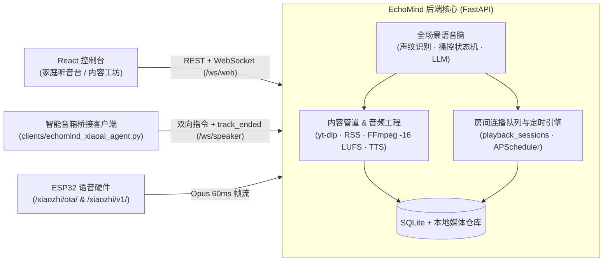

<div align="center">

# EchoMind

**声忆 — 自托管的家庭智能音箱、全龄有声内容库与声纹记忆中枢**

把音乐儿歌、绘本故事、分级英语课、RSS 播客、多房间音箱推送与家人声纹记忆，收进一个干净温暖的家庭私有服务。

[English](README.en.md) · [核心能力](#核心能力) · [快速开始](#快速开始) · [系统架构](#系统架构) · [智能音箱与硬件接入](#智能音箱与硬件接入) · [参与贡献](CONTRIBUTING.md)

[](https://github.com/lysforge/echomind/actions/workflows/ci.yml)
[](LICENSE)

</div>

EchoMind 是一个轻量级、可完全自托管运行的家庭音频与智能音箱控制中枢。它采用单栈架构（FastAPI + SQLite + React），无需依赖外部重型智能家居平台即可独立运行，支持一键部署至家中 NAS、Mac mini 或 Linux 主机，用统一的中文入口服务全家人从婴幼儿到成人各个阶段的声音内容与交互体验。

系统坚持**零假数据初始态**：首次安装后设备列表、家庭成员与个人记忆均保持纯净空白；首个注册账号自动成为管理员，并支持多用户 RBAC 权限隔离与四套现代界面主题一键切换（暖阳电台、极简科技、晴空伴学、深邃黑胶）。

---

## 核心能力

EchoMind 在交互架构上将日常使用与系统运营彻底分离——日常打开只有清爽的**家庭听音台**，管理员可一键切换进入**内容工坊与管理后台**。

### 1. 前台 · 家庭听音台

| 模块 | 核心体验与工程能力 |
| --- | --- |
| **发现与专辑库** | 将音乐儿歌、绘本故事、英语系列课与科普播客统一归口为「专辑 → 单集」容器；支持四频道 + 二级分类标签筛选、点击成员卡片按实际月龄自动置顶适龄专辑、断点续播、浏览器直听与全网搜歌即点即播。 |
| **房间音箱与定时** | 跨房间音频推送（Sonos / Connect 式体验），支持同时将整张专辑推送至多台音箱连播、切换顺序/单曲/随机循环、配置「按时间 / 按播完集数」轻柔睡眠定时以及每日定时播控日程。 |
| **家人声纹与记忆** | 支持按出生年月动态推算成长阶段（0-3 岁、3-6 岁、6-9 岁、9-12 岁、12-18 岁、全龄）与英语等级；网页录音采集声纹特征，严格划分「家庭共享 / 个人私密 / 成长动态」三层记忆隔离。 |
| **全局语音交互抽屉** | 随手呼出测试或下达自然语言播控指令（如点播指定故事第几集、调高/降低音量、下一首、设 20 分钟后停止、暂停与继续），兼容本地麦克风直录与键盘输入。 |

### 2. 后台 · 内容工坊与管理中心（仅管理员）

| 模块 | 管理与内容运营能力 |
| --- | --- |
| **专辑编目与分类** | 四频道二级分类标签自由增删维护，专辑封面表情、适用年龄段、英语等级、播放顺序编辑，以及单集文稿、单词卡和播放排序调整。 |
| **五大内容填充管道** | ① **语音缓存收件箱**（全网实时边播边存下来的音轨可在此试听后一键转正归入正式专辑）；② **本地目录挂载扫描**（自动识别 `.mp3/.m4a/.wav/.flac/.ogg/.opus/.aac` 及同名 `.txt` 绘本讲稿）；③ **上传与 URL 抓取**（本地上传音频或借助 `yt-dlp` 采集链接）；④ **播客 RSS 订阅追更**（探测源预览与增量去重同步）；⑤ **文本合音与 AI 英语制课**（输入中文/英文文本合成护耳有声读物，或一键生成 4 课时主题英语系列课）。 |
| **硬件·账号·系统设置** | 手动预置音箱与 6 位配对码自动发现认领、生成专属音箱桥接脚本、硬件护耳最大音量上限 `max_volume` 与夜间免打扰时段、LLM / ASR / 声纹外部模型参数配置及家庭普通成员账号 RBAC 管理。 |

---

## 关键工程机制

- **本地优先 → 高速在线秒播 + 静默缓存本地**：语音点播故事、儿歌或有声书时，优先检索本地媒体库；未命中时立即实时转码推流在线音源实现秒播，并在后台异步下载转码落盘存入收件箱，下次点播直接走本地流（断网环境下自动兜底本地适龄有声故事）。
- **文本按需合成与 `-16 LUFS` 护耳标准**：系统内置多套 `Pre-A1` 至 `B2+` 系列英语课程及故事讲稿，音频在首次播放时按需合成并缓存，所有入库音频默认通过 FFmpeg `loudnorm` 校准至 `-16 LUFS` 统一响度，避免设备间音量忽大忽小损伤儿童听力。
- **Sonos 级服务端队列与全场景语音播控状态机**：服务端为每台已连接音箱维护独立连播会话与进度状态；音箱播完单集自动上报 `track_ended` 推进下一集，配合 `max_volume` 音量硬钳位，即使语音喊出「音量调到 100」也会安全截断在设定的护耳上限内。
- **Fail-Safe 声纹安全默认态**：内置 64 维梅尔包络与基频 F0 声纹比对（亦支持对接外部 `3D-Speaker` 服务）。未识别出声纹或低于置信度阈值时自动回退至儿童安全模式，绝不泄漏成人个人私密记忆。

---

## 系统架构



---

## 快速开始

### 方式一：Docker Compose 一键部署（推荐用于 NAS / Linux 服务器）

确保已安装 Docker Engine / Docker Compose：

```bash
git clone https://github.com/lysforge/echomind.git
cd echomind
docker compose up -d --build
```

服务默认监听 `http://localhost:8090`，所有数据库与媒体文件持久化保存在当前目录 `./data` 下。如需在容器中扫描宿主机已有本地曲库目录，可取消 `docker-compose.yml` 中的卷挂载注释。

### 方式二：本机直接运行（macOS / Linux）

前置依赖：`Node.js 20+`、`Python 3.11 ~ 3.13` 以及系统安装 `ffmpeg`（macOS 可运行 `brew install ffmpeg`，Ubuntu/Debian 运行 `sudo apt install ffmpeg`）。

```bash
git clone https://github.com/lysforge/echomind.git
cd echomind
chmod +x start.sh
./start.sh
```

`start.sh` 会自动完成前端 TypeScript 编译打包、创建 Python 虚拟环境并启动后端服务（默认端口 `8090`，可通过环境变量 `PORT=9000 ./start.sh` 自定义）。

### 首次访问与初始化

1. 在浏览器打开 **`http://localhost:8090`**。
2. 注册第一个账号——**首个账号将自动成为平台超级管理员**。
3. 登录后弹出 3 步建家向导，可依次配置家庭与助手名称、大模型 API Key（支持 DeepSeek / OpenAI 兼容格式 / 本地 Ollama，留空也可先用本地离线意图引擎体验）、添加首名家庭成员及创建第一台音箱设备。
4. 管理员可点击左下角「内容工坊与管理后台」→「五大内容填充中心」体验内置示范课程导入、本地文件夹扫描、播客 RSS 追更或 AI 绘本合音。

---

## 智能音箱与硬件接入

- **任意音箱 / PC / 树莓派桥接**：在后台「硬件 · 账号 · 系统设置」新增音箱后，系统会生成独立 `auth_token` 与一键下载的预填充运行脚本 `clients/echomind_xiaoai_agent.py`，运行即可连入 `/ws/speaker` 接收实时播报、整张专辑队列推送及自然播完连播调度。
- **零配置自动发现**：未预先注册的设备直接连接 `/ws/speaker` 时会进入“待认领设备池”并收到 6 位随机配对码 `pair_code`，管理员在网页端输入配对码即可完成认领绑定。
- **ESP32 小智开源硬件兼容**：内置 `/xiaozhi/ota/` OTA 配置下发与 `/xiaozhi/v1/` WebSocket 二进制 Opus 音频网关，支持 60ms Opus 帧编解码推流与护耳动作指令安全限幅。

---

## 隐私、合规与安全提示

- **数据隔离与出境边界**：用户账号认证、家庭记忆、声纹向量、播放记录与音频库均保存在本地 `./data` 目录；仅当您在设置中配置了云端 LLM 或外部语音服务 API Key 时，对话或语音片段才会发往所配置的服务端。
- **局域网暴露安全**：建议仅在家庭内网或通过带访问认证的反向代理使用，请勿将未设强密码的控制台端口直接暴露至公网。
- **音频采集合规**：RSS 播客订阅、`yt-dlp` 链接抓取及全网搜索功能仅供个人与家庭合法收听学习缓存使用，请自觉遵守内容源站点的版权与使用条款。

---

## 开源许可

本项目基于 [MIT License](LICENSE) 开源。
